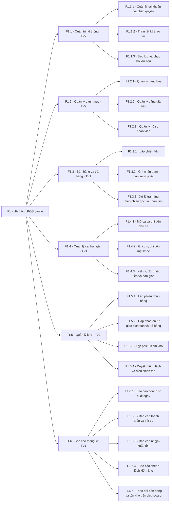

# Sơ đồ phân cấp chức năng hệ thống POS bán lẻ

Phạm vi gồm một cửa hàng có quầy thu ngân và kho. Cây chức năng có **1 nút gốc, 6 nhánh cấp 2 và 21 chức năng cấp 3**. Sơ đồ đọc từ trái sang phải. Mỗi đường nối biểu thị chức năng con thuộc chức năng cha.

## Cây chức năng hoàn chỉnh

## Phân công và truy vết

TV1 chủ trì F1.3, F1.4 và F1.6. TV2 chủ trì F1.1, F1.2 và F1.5. Trong nhánh báo cáo, mỗi thành viên thực hiện hai báo cáo và cả hai cùng xây dựng dashboard.

| Mã cấp 3 | Chức năng | Use case | Thực hiện |
|---|---|---|---|
| F1.1.1 | Quản lý tài khoản và phân quyền | UC10 | TV2 |
| F1.1.2 | Tra nhật ký thao tác | UC16 | TV2 |
| F1.1.3 | Sao lưu và phục hồi dữ liệu | UC17 | TV2 |
| F1.2.1 | Quản lý hàng hóa | UC18, UC06 | TV2 |
| F1.2.2 | Quản lý bảng giá bán | UC06 | TV2 |
| F1.2.3 | Quản lý hồ sơ nhân viên | UC19, UC10 | TV2 |
| F1.3.1 | Lập phiếu bán | UC02 | TV1 |
| F1.3.2 | Ghi nhận thanh toán và in phiếu | UC02 | TV1 |
| F1.3.3 | Xử lý trả hàng theo phiếu gốc và hoàn tiền | UC03 | TV1 |
| F1.4.1 | Mở ca và ghi tiền đầu ca | UC01 | TV1 |
| F1.4.2 | Ghi thu, chi tiền mặt khác | UC04 | TV1 |
| F1.4.3 | Kết ca, đối chiếu tiền và bàn giao | UC05 | TV1 |
| F1.5.1 | Lập phiếu nhập hàng | UC07 | TV2 |
| F1.5.2 | Cập nhật tồn từ giao dịch bán và trả hàng | UC02, UC03 | TV2 |
| F1.5.3 | Lập phiếu kiểm kho | UC08 | TV2 |
| F1.5.4 | Duyệt chênh lệch và điều chỉnh tồn | UC09 | TV2 |
| F1.6.1 | Báo cáo doanh số cuối ngày | UC11 | TV1 |
| F1.6.2 | Báo cáo thanh toán và kết ca | UC12 | TV1 |
| F1.6.3 | Báo cáo nhập–xuất–tồn | UC13 | TV2 |
| F1.6.4 | Báo cáo chênh lệch kiểm kho | UC14 | TV2 |
| F1.6.5 | Theo dõi bán hàng và tồn kho trên dashboard | UC15 | TV1 và TV2 |

## Hai nghiệp vụ nối quầy và kho

- **UC02 – Bán hàng và thanh toán.** F1.3.1 lập phiếu, F1.3.2 ghi nhận thanh toán. Khi xác nhận bán, F1.5.2 giảm tồn theo các dòng hàng đã bán.
- **UC03 – Trả hàng và hoàn tiền.** F1.3.3 tra phiếu gốc, ghi lượng trả và tiền hoàn. F1.5.2 tăng tồn bán được theo lượng hàng trả đủ điều kiện.

Xem tiền điều kiện, ngoại lệ và ví dụ kiểm thử trong [đặc tả use case POS](https://chatgpt.com/library?file_id=libfile_33342f001d34819193560c46ddd23ba4&account_id=personal).
