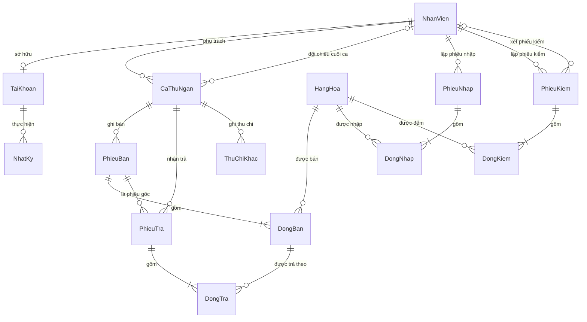
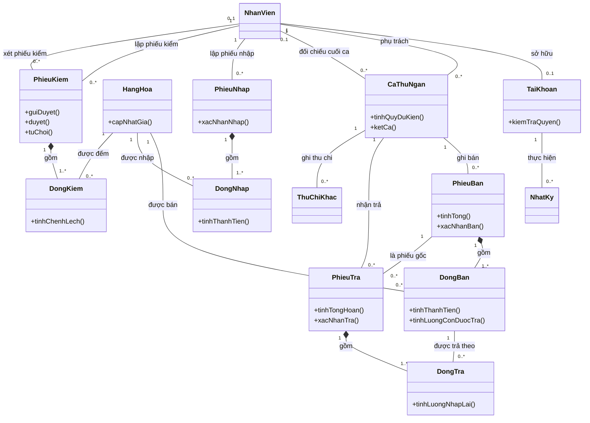

# POS tại một cửa hàng — ERD và mô hình miền

## 1. Phạm vi và cơ sở chỉnh sửa

Hệ thống phục vụ **một cửa hàng, một quầy thu ngân và một kho**. Thu ngân bán, nhận trả, thu/hoàn tiền, ghi thu chi và bàn giao ca. Nhân viên kho nhập, kiểm đếm và gửi phiếu. Quản lý cập nhật giá, đối chiếu ca và xét chênh lệch. Quản trị viên quản lý quyền, nhật ký, sao lưu và phục hồi. Phạm vi giai đoạn đầu loại trừ đa chi nhánh, bán trực tuyến, giao hàng, tiền lương, kế toán tổng hợp và hóa đơn điện tử.

Dùng trang 6 của hồ sơ khảo sát–thiết kế để xác định ranh giới; dùng 14 thực thể trên trang 14 và sơ đồ gốc để thống nhất tên; dùng BFD sáu nhánh và UC01–UC19 để rà độ phủ. Danh sách sau phân biệt dữ liệu cần lưu với báo cáo và kết quả tính toán.

| Khái niệm của bản trước | Cách biểu diễn trong phạm vi đã chốt |
|---|---|
| Vai trò | Thuộc tính của tài khoản, nhận một trong bốn giá trị. Quyền thao tác theo vai trò được kiểm tại tầng nghiệp vụ. |
| Giá bán | Hàng hóa giữ giá hiện hành. Dòng bán lưu đơn giá và giảm giá thực tế. Nhật ký thay đổi giá có thể lưu giá trước/sau để tra thao tác UC06. |
| Giao dịch tiền | Với một phương thức trên mỗi phiếu, lưu phương thức và tiền thu trên phiếu bán, phương thức và tiền hoàn trên phiếu trả. Ca thanh toán xác định qua chính phiếu. |
| Nhà cung cấp | UC07 vẫn chọn nhà cung cấp. Phiếu nhập lưu tên/định danh nguồn giao tại thời điểm nhận. Có thể chọn lại các giá trị đã dùng hoặc nhập mới khi lập phiếu; phạm vi hiện tại không có nghiệp vụ quản trị hồ sơ hay công nợ nhà cung cấp. |
| Biến động kho | Mỗi biến động truy về dòng chứng từ, loại nghiệp vụ và thời điểm có hiệu lực. Sổ kho và báo cáo nhập–xuất–tồn tổng hợp từ cùng nguồn này. |

## 2. ERD chung

Bội số đọc ở đầu gần thực thể được đếm. Ví dụ, một dòng bán thuộc đúng một phiếu bán; một phiếu bán đã ghi nhận có ít nhất một dòng. Bội số 1..* ở bốn quan hệ phiếu–dòng áp dụng cho chứng từ đã xác nhận hoặc phiếu kiểm đã gửi. Giỏ tạm và thao tác soạn phiếu có thể chưa có dòng. Hai liên kết giữa nhân viên và phiếu kiểm lần lượt ghi người lập và người xét; người xét trống khi chờ duyệt. Liên kết người đối chiếu cuối ca bổ sung cho UC05 so với sơ đồ gốc 18 liên kết; người đối chiếu được ghi khi hoàn tất bàn giao.

| Quan hệ n–n trước khi tách | Thực thể liên kết | Ý nghĩa của thuộc tính liên kết |
|---|---|---|
| Phiếu bán – Hàng hóa | DongBan | Số lượng, đơn giá và giảm giá của hàng trong lần bán này. |
| Phiếu nhập – Hàng hóa | DongNhap | Lượng thực nhận và đơn giá của hàng trong lần nhập này. |
| Phiếu kiểm – Hàng hóa | DongKiem | Tồn sổ, thực đếm và lý do lệch của hàng ở lần kiểm này. |

## 3. Mô hình miền

Sơ đồ lớp thể hiện đối tượng chịu trách nhiệm xử lý. Hình thoi đặc biểu thị dòng chi tiết là bộ phận của phiếu. Liên kết từ dòng trả đến dòng bán là tham chiếu nghiệp vụ: phiếu trả không sở hữu dòng bán gốc.

| Lớp miền | Bảng đối chiếu trong thiết kế | Thuộc tính nghiệp vụ chính | Trách nhiệm |
|---|---|---|---|
| NhanVien | `nhan_vien` | Mã NV, họ tên, trạng thái | Nhận diện thu ngân, người lập phiếu kho và người quản lý đối chiếu hoặc duyệt. |
| TaiKhoan | `tai_khoan` | Mã TK, tên đăng nhập, mật khẩu băm, vai trò, trạng thái | Áp dụng một trong bốn vai trò khi gọi nghiệp vụ. |
| NhatKy | `nhat_ky` | Mã nhật ký, thời điểm, thao tác, loại và mã đối tượng, kết quả | Ghi nhận thao tác gắn tài khoản để truy lại chứng từ và kết quả. |
| HangHoa | `hang_hoa` | Mã hàng, mã vạch, tên, quy cách, đơn vị, giá hiện hành, trạng thái, số dư mở sổ | Một mã ứng với một quy cách bán và đếm; cung cấp giá cho lần bán mới. |
| CaThuNgan | `ca_thu_ngan` | Mã ca, giờ mở/đóng, tiền đầu ca, quỹ dự kiến khi chốt, tiền thực đếm, giải trình, trạng thái | Xác định ca phát sinh, tính quỹ và ghi bàn giao. |
| PhieuBan | `phieu_ban` | Mã bán, thời điểm, phương thức thu, số tiền thu, trạng thái | Xác nhận giao dịch, tính tổng từ các dòng và cho in lại. |
| DongBan | `dong_ban` | Mã dòng bán, lượng bán, đơn giá lúc bán, giảm giá áp dụng | Giữ giá trị giao dịch gốc, xác định lượng còn được trả. |
| PhieuTra | `phieu_tra` | Mã trả, thời điểm, phương thức hoàn, tổng tiền hoàn, trạng thái | Hoàn theo một phiếu bán gốc trong ca nhận trả. |
| DongTra | `dong_tra` | Mã dòng trả, lượng trả, tình trạng, tiền hoàn của dòng | Tham chiếu dòng bán gốc và xác định lượng nhập lại. |
| ThuChiKhac | `thu_chi_khac` | Mã thu chi, thời điểm, loại thu/chi, số tiền, lý do, trạng thái | Ghi một khoản tiền mặt ngoài giao dịch bán/trả. |
| PhieuNhap | `phieu_nhap` | Mã nhập, thời điểm xác nhận, nhà cung cấp trên chứng từ, trạng thái | Xác nhận hàng thực nhận, tính giá trị nhập. |
| DongNhap | `dong_nhap` | Mã dòng nhập, lượng thực nhận, đơn giá nhập | Ghi lượng và giá mua của đúng mã hàng. |
| PhieuKiem | `phieu_kiem` | Mã kiểm, thời điểm lập/gửi/xét, trạng thái, lý do từ chối | Quản lý luồng lập, gửi, duyệt hoặc từ chối kiểm kho. |
| DongKiem | `dong_kiem` | Định danh ghép (phiếu kiểm, hàng hóa), tồn sổ tại lúc đếm, thời điểm đếm, thực đếm, giải trình | Ghi căn cứ kiểm, phân biệt chưa đếm và đếm bằng 0. |

**Đơn vị và lịch sử.** Tiền tính bằng đồng Việt Nam. Mã hàng xác định một quy cách và đơn vị đếm xuyên suốt bán/nhập/trả/kiểm. Một mã vạch định danh tối đa một mã hàng. Giá mới có hiệu lực cho lần bán tiếp theo; giao dịch cũ giữ số lượng, đơn giá, giảm giá và số tiền đã chốt. Khi cho phép một phiếu có nhiều phương thức thanh toán, quan hệ phiếu–khoản tiền sẽ đổi thành 1–n; khi đó mới cần tách khoản thanh toán và đối chiếu tổng các khoản với tổng phiếu.

## 4. Quy tắc liên phân hệ và số liệu dẫn xuất

1. **UC01/05 — ca quầy.** Một quầy có tối đa một ca đang mở. Ghi ca thực hiện trên phiếu bán, phiếu trả và thu chi. Quản lý ghi nhận bàn giao sau khi có số thực đếm và giải trình chênh lệch.
2. **UC02 — bán và thu tiền.** Kiểm tra giá, tồn và ca tại lúc xác nhận. Tổng thu bằng tổng thành tiền dòng sau giảm; tiền khách đưa trừ tiền thừa bằng tiền thu nếu trả tiền mặt. Chỉ ghi một giao dịch bán dù thử lại hoặc in lại. Tiền chuyển khoản do thu ngân xác nhận.
3. **UC03 — trả và hoàn.** Dòng trả phải trỏ đến dòng bán thuộc phiếu gốc của phiếu trả. Lượng còn trả được bằng lượng đã bán trừ tổng lượng trả hiệu lực của chính dòng đó. Hoàn theo giá trị thực bán sau giảm và giới hạn tổng tiền hoàn của dòng ở số đã thu. Ghi ca nhận trả và phương thức thực tế hoàn. Hàng trả hỏng vẫn ghi tiền hoàn theo phiếu; chỉ lượng còn bán được mới làm tăng tồn.
4. **UC04/05 — bàn giao.** Quỹ dự kiến = tiền đầu ca + bán tiền mặt − hoàn tiền mặt + thu khác − chi khác. Chênh bàn giao = thực đếm − dự kiến. Thu hoặc hoàn bằng chuyển khoản xuất hiện ở báo cáo phương thức; chỉ phần tiền mặt đi vào ngăn kéo.
5. **UC07/13 — sổ kho.** Với mỗi mã hàng, tồn cuối kỳ = tồn đầu kỳ + thực nhập − thực bán + trả bán được + điều chỉnh kiểm đã duyệt có dấu. Số dư mở sổ là số tồn tại mốc khởi tạo cửa hàng; tồn đầu các kỳ sau được tính từ chứng từ trước kỳ. Với phiếu kiểm dùng thời điểm duyệt, với bán/nhập/trả dùng thời điểm xác nhận. Tổng hợp từng nguồn theo mã hàng trước khi ghép báo cáo.
6. **UC08/09 — kiểm đếm.** Một phiếu chỉ có một dòng cho mỗi mã hàng. Phiếu đi từ Nháp sang Chờ duyệt rồi Đã duyệt hoặc Từ chối. Chưa đếm khác với đếm bằng 0. Nếu có phát sinh sau khi đếm, yêu cầu đối chiếu và xác nhận lại căn cứ trước khi duyệt; chỉ ghi hiệu lực điều chỉnh một lần. Giữ người xét, thời gian, căn cứ và lý do.
7. **Hiệu lực chứng từ.** Khi xác nhận bán hoặc trả, dữ liệu đầu phiếu, các dòng, tiền và tác động kho phải có hiệu lực cùng nhau. Lỗi giữa chừng hoàn tác toàn bộ; chặn hai giao dịch đồng thời vượt tồn hoặc trả vượt lượng gốc. Chứng từ hủy trước xác nhận không tác động doanh số, tiền hay kho. Nhật ký cho phép tra trạng thái và mã chứng từ sau gián đoạn.

## 5. Rà soát đủ 19 use case

| UC / BFD | Dữ liệu hoặc kết quả đối chiếu |
|---|---|
| UC01 · F1.4.1 | Nhân viên mở CaThuNgan, nhập tiền đầu ca. |
| UC02 · F1.3.1–2, F1.5.2 | CaThuNgan, HangHoa, PhieuBan, DongBan. Phiếu chứa khoản thu; dòng bán có hiệu lực ghi xuất kho. |
| UC03 · F1.3.3, F1.5.2 | PhieuTra, DongTra, CaThuNgan, PhieuBan, DongBan. Theo phiếu gốc để giới hạn lượng và tiền hoàn. |
| UC04 · F1.4.2 | ThuChiKhac gắn CaThuNgan, có chiều thu hoặc chi. |
| UC05 · F1.4.3 | Tổng hợp PhieuBan, PhieuTra, ThuChiKhac của ca; đối chiếu với thực đếm và ghi người bàn giao/đối chiếu. |
| UC06 · F1.2.1–2 | Đổi giá trên HangHoa, truy thao tác qua NhatKy. DongBan cũ giữ giá tại lần bán. |
| UC07 · F1.5.1 | PhieuNhap lưu nhà cung cấp và người lập; DongNhap ghi hàng, lượng thực nhận, đơn giá. |
| UC08 · F1.5.3 | PhieuKiem và DongKiem lưu căn cứ, thực đếm và giải trình lệch. |
| UC09 · F1.5.4 | PhieuKiem ghi quyết định, người xét, thời điểm; DongKiem cung cấp lượng điều chỉnh. |
| UC10 · F1.1.1, F1.2.3 | NhanVien và TaiKhoan; tên đăng nhập duy nhất, kiểm quyền theo vai trò. |
| UC11 · F1.6.1 | Doanh số ngày và tiền hoàn từ các phiếu hiệu lực, theo ngày phát sinh của từng phiếu. |
| UC12 · F1.6.2 | Đối chiếu tiền thu/hoàn từng phương thức, thu chi khác và số bàn giao của CaThuNgan. |
| UC13 · F1.6.3 | Nhập–xuất–tồn theo mã hàng từ bốn loại chứng từ và số dư mở sổ. |
| UC14 · F1.6.4 | So tồn căn cứ, lượng đếm, chênh và trạng thái xét trên PhieuKiem/DongKiem. |
| UC15 · F1.6.5 | Kết hợp doanh số và tồn đã tổng hợp theo cùng mã hàng, cùng mốc thời gian. |
| UC16 · F1.1.2 | Tra NhatKy theo TaiKhoan, thời điểm, thao tác và đối tượng. |
| UC17 · F1.1.3 | Sao lưu/phục hồi toàn bộ dữ liệu, kiểm quyền và ghi nhật ký thao tác quản trị. Tệp sao lưu là tài nguyên vận hành. |
| UC18 · F1.2.1 | Quản lý mã hàng, mã vạch, quy cách và trạng thái HangHoa. |
| UC19 · F1.2.3 | Quản lý NhanVien; giữ danh tính đã gắn chứng từ. |

## 6. Kiểm chứng trên mô hình

| Tình huống | Kết quả phải truy ra được |
|---|---|
| PB015 bán 2 hộp × 25.000 đồng, chuyển khoản, tồn trước bán 20 | Phiếu thu 50.000 đồng; tồn còn 18; tiền mặt trong ca tăng 0. In lại cho cùng mã PB015. |
| Đổi giá thành 30.000 rồi khách trả 1 hộp còn bán được vào ca sau | Dòng trả dẫn về giá 25.000 trên DongBan; ghi khoản hoàn vào ca sau; tồn tăng 1, khách còn được trả 1. |
| Sau lần trả trên, khách yêu cầu trả thêm 2 hộp | Chặn do vượt lượng còn được trả. Nếu chỉ trả 1 hộp hỏng được chấp nhận thì ghi tiền hoàn, tồn bán được giữ nguyên. |
| Tồn sổ 20, thực đếm 18 | Gửi phiếu vẫn giữ 20. Duyệt hợp lệ khi không có phát sinh xen giữa thì điều chỉnh −2; từ chối giữ 20. |
| Ca đầu 200.000, bán tiền mặt 100.000, hoàn tiền mặt 25.000, chi khác 10.000; thực đếm 260.000 | Quỹ dự kiến 265.000 đồng, thiếu 5.000 đồng, lưu người đối chiếu và giải trình. |

**Đối chiếu mục 3.2.** 14 thực thể, 14 lớp miền, 3 lớp liên kết nhiều–nhiều có thuộc tính. Định lượng này thuộc mô hình phân tích; sơ đồ lớp thiết kế ở mục 4.1 có phạm vi khác. Công nợ và quá hạn xuất hiện trong tiêu chí dữ liệu mẫu 1.3 nhưng chưa có trong phạm vi nghiệp vụ đã xác lập. Nhóm cần làm rõ cách chấm mục đó trước khi chuẩn bị dữ liệu mẫu.

**Nguồn nội bộ:** [Hồ sơ phạm vi, trang 6 và 14](https://chatgpt.com/library?file_id=libfile_df47d6e59e648191a15ffabf87d77417&account_id=personal) · [Sơ đồ gốc, trang 02](https://chatgpt.com/library?file_id=libfile_2e0d82a0122c8191991b32bc2dfac0d1&account_id=personal) · [BFD](https://chatgpt.com/library?file_id=libfile_54054387ac308191b30ca07ae76929d2&account_id=personal) · [Use case](https://chatgpt.com/library?file_id=libfile_33342f001d34819193560c46ddd23ba4&account_id=personal) · [Checklist MI4090](https://chatgpt.com/library?file_id=libfile_908ab72118c0819192955ec8979c3d89&account_id=personal).
