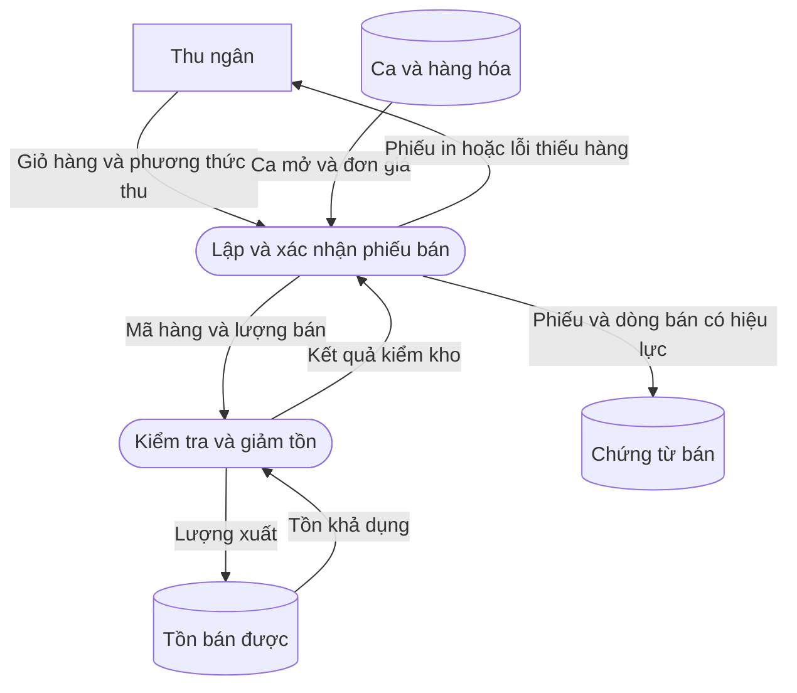
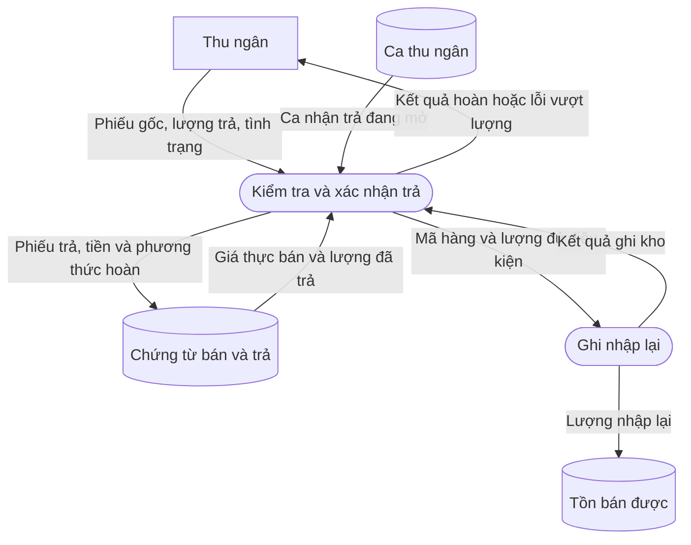

# POS một cửa hàng · Mục 3.3 — Quy tắc nghiệp vụ và phân quyền

**Phạm vi.** Một quầy, một kho, bốn vai trò. Tên lớp theo ERD 14 thực thể; mã UC và F theo danh mục 19 use case và BFD sáu nhánh. Khách hàng giao dịch qua thu ngân. TV1/TV2 là người phụ trách bài tập, tách biệt với người có quyền thao tác.

## 1. Quy tắc và hợp đồng Service

Điều kiện chung cho mọi lệnh: phiên đăng nhập hợp lệ, tài khoản đang hoạt động và vai trò có quyền. Service tra vai trò từ tài khoản của phiên trong CSDL. Những ca kiểm dưới đây gọi trực tiếp Service. Mã BFD trong bảng lược tiền tố F. Số ca kiểm tương ứng tên phương thức test trong tệp minh chứng.

| Quy tắc | Chủ trì | UC / BFD | Người có quyền | Điều kiện trước | Kết quả sau và xử lý lỗi | Lớp miền liên quan | PosService | Ca kiểm |
|---|---|---|---|---|---|---|---|---|
| BR01 | TV1 | UC01 · 1.4.1 | Thu ngân | Quầy chưa có ca mở hoặc chờ bàn giao; tiền đầu ca ≥ 0. | Mở đúng một ca, gắn người mở và tiền đầu ca. Chặn ca trùng kể cả khác thu ngân. | CaThuNgan | mo_ca | 01 |
| BR02 | TV1 | UC02 · 1.3.1–2 ↔ 1.5.2 | Thu ngân | Có ca mở của mình, phiếu có dòng, mã hàng hợp lệ, lượng dương, đủ tồn, chọn TM/CK. | Ghi giá và tiền thực bán, giảm tồn đúng số lượng, ghi phương thức thu. Một dòng lỗi thì hoàn tác cả phiếu. In lại theo mã cũ. | PhieuBan, DongBan, HangHoa, CaThuNgan | ban | 02, 03 |
| BR03 | TV1 | UC03 · 1.3.3 ↔ 1.5.2 | Thu ngân | Ca nhận trả đang mở; dòng bán thuộc phiếu gốc hoàn tất. Lượng trả ≤ lượng mua trừ lượng đã trả hiệu lực. | Hoàn theo giá thực bán sau giảm; ghi tình trạng từng dòng, chỉ cộng tồn hàng bán lại được. Chặn vượt lượng và hoàn tác toàn bộ lần trả lỗi. | PhieuTra, DongTra, DongBan, CaThuNgan, HangHoa | tra | 03 |
| BR04 | TV1 | UC04–05 · 1.4.2–3 | Thu ngân ghi và bàn giao; quản lý chốt | Thu/chi khác có số tiền dương và lý do, thuộc ca đang mở. Khi bàn giao, nhập thực đếm; lệch phải có giải trình. | Quỹ dự kiến = đầu ca + bán TM − hoàn TM + thu khác − chi khác. Lưu dự kiến, thực đếm, giải trình; quản lý đối chiếu rồi đóng. Ca bàn giao dừng nhận giao dịch. | CaThuNgan, ThuChiKhac, PhieuBan, PhieuTra | thu_chi, ban_giao, chot | 02, 04 |
| BR05 | TV2 | UC06 · 1.2.1–2 | Quản lý | Mã hàng/quy cách tồn tại; giá mới nguyên đồng và ≥ 0. | Áp dụng giá mới cho lần bán sau. Dòng đã bán giữ đơn giá và giảm giá, kể cả khi hoàn sau đổi giá. | HangHoa, DongBan | doi_gia | 03, 05 |
| BR06 | TV2 | UC07 · 1.5.1 | Nhân viên kho | Có nhà cung cấp trên phiếu, ít nhất một dòng hợp lệ; lượng thực nhận dương, đơn giá nhập ≥ 0. | Ghi người lập, chứng từ, các dòng và tăng tồn cùng giao dịch. Một dòng sai thì hoàn tác cả lần nhập. | PhieuNhap, DongNhap, HangHoa | nhap | 06 |
| BR07 | TV2 | UC08 · 1.5.3 | Nhân viên kho | Có căn cứ tồn lúc đếm; mỗi mã hàng xuất hiện một lần; mọi dòng đã đếm, kể cả khi đếm được 0. | Ghi phiếu Chờ duyệt, lưu tồn căn cứ và thực đếm; tồn bán được giữ nguyên. Chặn phiếu rỗng, dòng thiếu hoặc trùng. | PhieuKiem, DongKiem | moc_dem, gui_kiem | 07 |
| BR08 | TV2 | UC09 · 1.5.4 | Quản lý | Phiếu Chờ duyệt; nếu sổ kho thay đổi sau đếm, phải đối chiếu trước khi điều chỉnh. | Duyệt: cộng đúng thực đếm trừ tồn căn cứ một lần; lưu người và thời điểm. Từ chối: lưu lý do, giữ tồn. Sai quyền hoặc duyệt lại: giữ nguyên dữ liệu. | PhieuKiem, DongKiem, HangHoa | xet_kiem | 08, 09 |

**Hai giao dịch liên phân hệ.** BR02 và BR03 do TV1 chủ trì chứng từ quầy, TV2 phối hợp phần cập nhật tồn. Mỗi quy tắc chỉ tính một lần trong phân công. Đơn vị lượng theo quy cách của mã hàng. Tiền tính bằng đồng; bản minh chứng biểu diễn giảm giá bằng số đồng trên một đơn vị, lưu trên dòng bán để hoàn nhiều lần vẫn đúng giá gốc. Chỉ phiếu đã xác nhận mới được ghi vào tập chứng từ hiệu lực. BR04 áp dụng cho khoản thu/chi ngoài bán và trả; cùng một chứng từ quỹ có một mã duy nhất.

## 2. Ma trận phân quyền theo use case

✓ là quyền thực hiện. Dấu — là từ chối. Với UC05 và UC12, ô ghi rõ quyền theo hành động và phạm vi dữ liệu. Quản trị viên phụ trách tài khoản và vận hành hệ thống; quyền duyệt nghiệp vụ giao riêng cho quản lý.

| UC | Nghiệp vụ | Thu ngân | Nhân viên kho | Quản lý | Quản trị viên |
|---|---|---|---|---|---|
| UC01 | Mở ca | ✓ | — | — | — |
| UC02 | Bán và thanh toán | ✓ | — | — | — |
| UC03 | Trả và hoàn tiền | ✓ | — | — | — |
| UC04 | Thu chi khác | ✓ | — | — | — |
| UC05 | Kết ca | Đếm, giải trình, bàn giao | — | Đối chiếu, chốt | — |
| UC06 | Cập nhật giá | — | — | ✓ | — |
| UC07 | Nhập hàng | — | ✓ | — | — |
| UC08 | Kiểm đếm, gửi phiếu | — | ✓ | — | — |
| UC09 | Xét chênh lệch | — | — | ✓ | — |
| UC10 | Tạo tài khoản, gán vai trò | — | — | — | ✓ |
| UC11 | Báo cáo doanh số ngày | — | — | ✓ | — |
| UC12 | Đối chiếu thanh toán và ca | Ca của mình | — | Các ca | — |
| UC13 | Báo cáo nhập–xuất–tồn | — | ✓ | ✓ | — |
| UC14 | Báo cáo chênh kiểm | — | ✓ | ✓ | — |
| UC15 | Dashboard tổng hợp | — | — | ✓ | — |
| UC16 | Tra nhật ký | — | — | — | ✓ |
| UC17 | Sao lưu và phục hồi | — | — | — | ✓ |
| UC18 | Quản lý hàng hóa | — | — | ✓ | — |
| UC19 | Quản lý hồ sơ nhân viên | — | — | ✓ | — |

**Căn cứ phân quyền.** UC01–10 dùng tác nhân đã chốt trong đặc tả. Với UC11–19, đặc tả chủ yếu ghi người làm bài tập. Ma trận cụ thể hóa quyền vận hành theo phân công quầy/kho/quản lý/quản trị; giới hạn thu ngân xem ca của mình là quyết định thiết kế. UC18, UC19 thuộc quản lý; UC10 do quản trị viên thực hiện trên hồ sơ nhân viên có sẵn. Bản minh chứng định nghĩa chính sách cho mọi UC trong `QUYEN`; các chức năng báo cáo, danh mục và sao lưu đầy đủ thuộc các phần sản phẩm tương ứng.

## 3. DFD logic đối chiếu cho UC02 và UC03

Hai hình là lát cắt luồng dữ liệu của F1.3 và F1.5.2. Kho dữ liệu nhóm các thực thể đã có trong ERD. Tồn khả dụng khi triển khai được đối chiếu với chứng từ nhập, bán, trả và kiểm đã duyệt. Bảng số dư trong minh chứng là giá trị tổng hợp để kiểm thử giao dịch.

## 4. Minh chứng chạy và cách bảo vệ

**Chạy lại.** Giải nén gói, mở thư mục chứa `pos_service.py`, chạy `python -B test_muc33.py` bằng Python 3.10 trở lên. Bộ kiểm dùng SQLite trong bộ nhớ, tạo CSDL riêng cho từng ca và gọi trực tiếp phương thức nghiệp vụ. Tệp `ket_qua.txt` lưu kết quả chạy thực tế.

| Thao tác trình diễn | Kết quả đã kiểm | Minh chứng |
|---|---|---|
| Nhân viên kho lập phiếu kiểm tồn sổ 20, đếm 18; lần lượt nhân viên kho, thu ngân và quản trị viên gọi trực tiếp `xet_kiem` | Cả ba bị từ chối; phiếu vẫn Chờ duyệt, người xét trống, tồn 20. Quản lý duyệt thì tồn còn 18; duyệt lại bị chặn. | test_08 |
| Có bán hàng trong thời gian chờ duyệt | Duyệt bị chặn. Quản lý có thể từ chối và lưu lý do để kiểm lại; tồn giữ theo giao dịch bán đã phát sinh. | test_09 |
| Bán 2 hộp giá 25.000 bằng chuyển khoản, sau đó thử một phiếu có dòng thứ hai thiếu tồn | Phiếu đầu thu 50.000 đồng, tồn còn 18, quỹ tiền mặt giữ nguyên. Phiếu sau hoàn tác cả dòng đầu. | test_02 |
| Trả nhiều lần, giá đã thay đổi, một hộp không còn bán được | Hoàn theo đơn giá sau giảm lúc mua; lần trả vượt bị chặn; hàng hỏng không tăng tồn bán được. | test_03 |
| Kiểm quyền quản trị và phạm vi dữ liệu | Quản lý bị từ chối UC10, quản trị viên được cấp quyền UC10, tài khoản bị khóa bị từ chối; thu ngân khác không đọc được quỹ ca. | test_10 |

### Đối chiếu từng yêu cầu của checklist

| Tiêu chí 3.3 | Minh chứng |
|---|---|
| Ít nhất 8 quy tắc, 4/người | [TV1] BR01–04; [TV2] BR05–08 · bảng 1 · `PosService` · 4 + 4. |
| Ít nhất 2 quy tắc liên phân hệ | [TV1/TV2] BR02, BR03 · bảng 1 và DFD · `ban`, `tra`. |
| Điều kiện trước, kết quả sau, quyền gọi | [TV1/TV2] Bảng 1 và ma trận 19 UC. |
| Kiểm quyền ở Domain/Service, ít nhất 3 vai trò | [TV1/TV2] `PosService.ghi` gọi `quyen` trước khi ghi; kiểm bốn vai trò và tài khoản khóa. |
| Thử tài khoản thiếu quyền gọi thẳng Service | [TV2] test_08, test_09, test_10, đối chiếu trạng thái trước/sau. |
| Đối chiếu DFD | [TV1/TV2] Hai DFD ở mục 3 cho hai giao dịch quầy–kho. |

**Mức hoàn thành.** Đã đặc tả và chạy minh chứng mục 3.3 độc lập với giao diện. CSDL kiểm thử lưu tập trường cần cho tám quy tắc; phiên đăng nhập do bộ kiểm thiết lập và tài khoản được tra lại trước mỗi thao tác. Nhóm cần nối các hợp đồng này vào Solution POS chính, dùng danh tính do phần đăng nhập cấp, đưa giao dịch từ hai module vào cùng transaction, rồi chạy lại khi đánh dấu hoàn tất trên sản phẩm nộp. Mười ca kiểm này là minh chứng 3.3; việc phân loại và hoàn thiện bộ kiểm thử của mục 5 thực hiện riêng.

**Tài liệu đối chiếu** · [Checklist 3.3](https://chatgpt.com/library?file_id=libfile_908ab72118c0819192955ec8979c3d89&account_id=personal) · [ERD hiện hành](https://chatgpt.com/library?file_id=libfile_e218f1459cb08191b6c17cb9dadbc599&account_id=personal) · [Use case](https://chatgpt.com/library?file_id=libfile_33342f001d34819193560c46ddd23ba4&account_id=personal) · [BFD](https://chatgpt.com/library?file_id=libfile_54054387ac308191b30ca07ae76929d2&account_id=personal).
