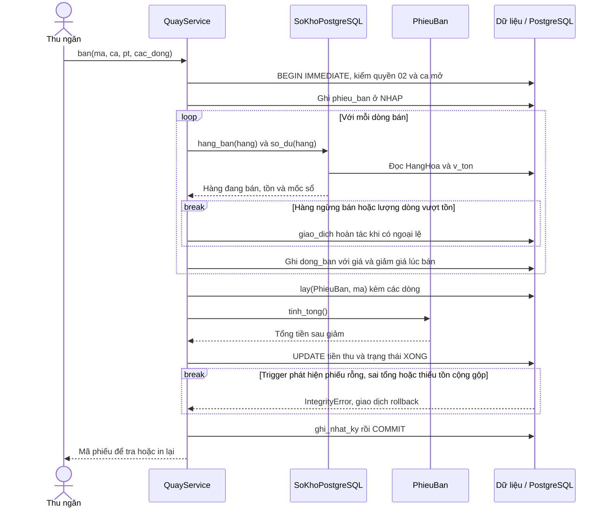
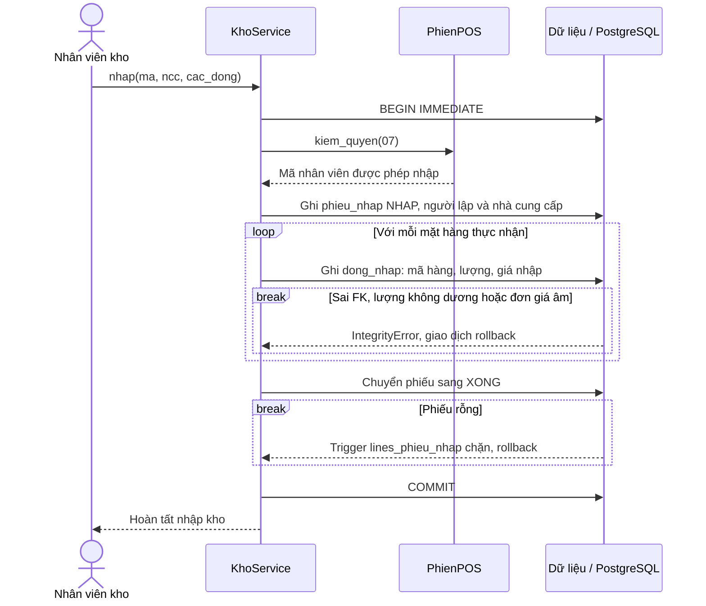
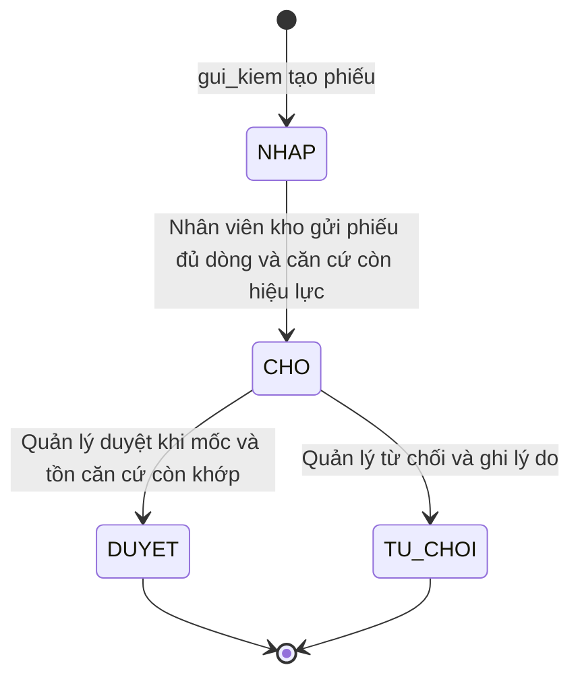

# Mục 4.2 · Hành vi hệ thống POS

Bốn sơ đồ mô tả mã nguồn Python và schema PostgreSQL của repo. “Dữ liệu / PostgreSQL” gộp KhoDuLieu và kết nối PostgreSQL để dễ đọc. Khung **break** kết thúc lần gọi khi điều kiện lỗi xảy ra; khung **loop** lặp cho từng dòng. Mũi tên từ người dùng biểu diễn yêu cầu nghiệp vụ tại biên Service. Các SVG cùng tên dùng để trình chiếu ngoại tuyến.

## UC02 · Bán hàng và thanh toán

TV1 · BR02 · Quầy gọi Kho trước khi chốt phiếu bán.



Khi XONG, v_bien_dong biểu diễn xuất kho. In lại đọc phiếu cũ.

## UC03 · Trả hàng và hoàn tiền

TV1 · BR03 · Ca nhận trả có thể khác ca bán.

```mermaid
sequenceDiagram
    actor A as Thu ngân
    participant Q as QuayService
    participant B as DongBan
    participant D as Dữ liệu / PostgreSQL
    A->>Q: tra(ma, ca, goc, pt, cac_dong)
    Q->>D: BEGIN IMMEDIATE, kiểm quyền 03 và ca nhận trả
    Q->>D: Tạo phieu_tra ở NHAP, tham chiếu phiếu gốc
    loop Với mỗi dòng trả
    Q->>D: lay(DongBan, ma_dong) để truy dòng bán gốc
    break DongBan thuộc phiếu gốc khác
    Q->>D: Hoàn tác rồi trả lỗi sai phiếu gốc
    end
    Q->>D: Tổng lượng đã trả hiệu lực và dòng tạm cùng phiếu
    Q->>B: luong_con_tra(da_tra)
    break Số lượng yêu cầu vượt lượng còn được trả
    Q->>D: giao_dich hoàn tác đầu phiếu và dòng đã ghi
    end
    Q->>D: Ghi lượng trả và tình trạng TOT hoặc HONG
    Q->>Q: Cộng lượng × (đơn giá gốc − giảm giá gốc)
    end
    Q->>D: UPDATE tiền hoàn, chuyển XONG; trigger kiểm lại
    break Phiếu rỗng hoặc vi phạm ràng buộc khi chốt
    D-->>Q: IntegrityError, giao dịch rollback
    end
    Q->>D: ghi_nhat_ky rồi COMMIT
    Q-->>A: Mã phiếu trả
```

v_bien_dong chỉ nhập lại dòng TOT. Dòng HONG vẫn được tính hoàn tiền.

## UC07 · Nhập hàng vào kho

TV2 · BR06 · Một giao dịch bao gồm đầu phiếu và mọi dòng nhập.



v_bien_dong lấy lượng nhập từ các dòng của phiếu XONG. v_ton cộng theo mã hàng.

## UC08–UC09 · Vòng đời phiếu kiểm kho

TV2 · BR07, BR08 · Đối tượng là một `PhieuKiem`. Mốc sổ là số phát sinh có hiệu lực của SKU, nên hai giao dịch bù trừ về lượng vẫn có thể làm mốc thay đổi.



| Chuyển hoặc thử thao tác | Điều kiện tại Service và PostgreSQL | Tác động sau commit |
|---|---|---|
| Tạo → NHAP → CHO | `moc_dem()` lấy tồn, mốc sổ và giờ đếm. `gui_kiem()` kiểm quyền UC08 rồi tạo nháp, ghi dòng và gửi trong cùng transaction. Mỗi SKU xuất hiện một lần; lượng đếm là số nguyên không âm. Trigger chặn phiếu rỗng, NULL thực đếm, mốc/tồn cũ. | Gửi thành công lưu CHO, tồn giữ nguyên. Nếu gửi lỗi, rollback cả phiếu vừa lập. NHAP là trạng thái trung gian của lần gọi này. |
| CHO → DUYET | `xet_kiem()` kiểm quyền UC09, kiểm kiểu quyết định và `cho_phep_xet()`. Trigger count_ready rà từng dòng tại thời điểm xét. | Lưu người xét, thời điểm. Mỗi dòng có lệch góp lượng thực đếm trừ tồn sổ vào view kho đúng một lần. |
| CHO → TU_CHOI | Quản lý chọn từ chối và nhập lý do có nội dung. | Lưu quyết định, người và thời điểm; tồn giữ nguyên. |
| CHO, căn cứ đã đổi | Yêu cầu duyệt bị chặn, phiếu vẫn CHO. Trong kịch bản TV2, quản lý từ chối PK1 có lý do, nhân viên kho đếm lại trên PK2. | Không ghi điều chỉnh theo số đếm cũ. |
| DUYET → TU_CHOI hoặc DUYET lần nữa | `cho_phep_xet()` trả False; `yeu_cau()` ném ValueError trước lệnh UPDATE. Trigger transition_phieu_kiem cũng bảo vệ nếu ghi SQL trực tiếp. | Phiếu và tồn giữ nguyên. Hai trạng thái cuối giữ lịch sử để tra cứu. |

### Truy vết về mã 4.1

| Sơ đồ | Điểm vào và điều kiện chính | Cách kiểm |
|---|---|---|
| UC02 | application/quay.py `ban`, :107 `so_du`; trigger sale_total và view v_bien_dong | TV1 bán 2 đơn vị thành công; phiếu kế tiếp có hai dòng cùng mã tổng vượt tồn bị hoàn tác. |
| UC03 | application/quay.py `tra`; `DongBan.luong_con_tra`; trigger return_checks, view v_dong_tra và v_bien_dong | TV1 đổi giá, mở ca sau, hoàn một hộp tốt và một hộp hỏng; chặn trả vượt. |
| UC07 | application/kho.py `nhap`; CHECK của dong_nhap, trigger lines_phieu_nhap, view v_ton | TV2 nhập lỗi ở dòng thứ hai rồi nhập hợp lệ; đối chiếu tồn 20 → 23. |
| UC08–09 | application/kho.py, :224, :234; domain.py:193; các trigger count_ready và transition_phieu_kiem | TV2 kiểm tra căn cứ đã đổi, sai quyền và thử xét phiếu đã duyệt. |

PostgreSQL chạy trigger và tính view bên trong bộ máy CSDL. Stack Python hiển thị đến lời gọi PostgreSQL; đọc kết quả view và trạng thái chứng từ để kiểm phần tác động dữ liệu.
